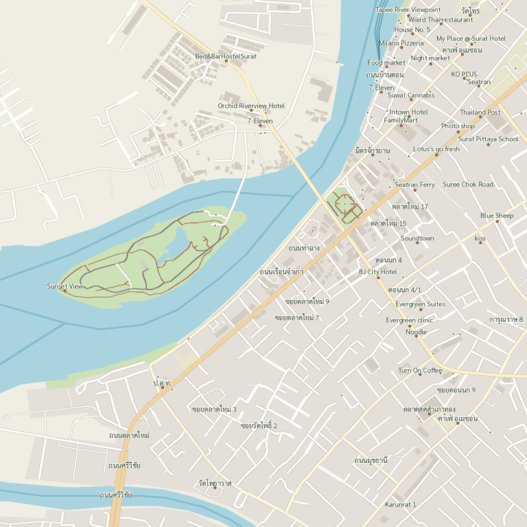

# ESP32 CYD Survival Wiki — ฉบับภาษาไทย

คู่มือเอาตัวรอดภาษาไทยสำหรับ ESP32-2432S028R (CYD 2.8 นิ้ว) รุ่น **1.7.0-th1** พร้อมแผนที่ออฟไลน์ทั้งจังหวัด การค้นหาสถานที่ เส้นทาง GPX และเมนู GPS สำหรับกลับจุดเริ่ม ดูเวลา และเก็บสถิติเดินทาง

## ติดตั้งผ่านเว็บ

ต่อ CYD 2.8 นิ้วกับคอมพิวเตอร์ด้วยสาย USB สำหรับส่งข้อมูล แล้วเปิดหน้าแฟรชใน Chrome หรือ Edge [หน้าแฟรชภาษาไทย](https://zmikiz1423.github.io/esp32-cyd-survival-wiki-thai/)

## ดาวน์โหลดไฟล์พร้อมใช้

ผู้ที่ใช้รุ่น `1.6.0-th4` อยู่แล้วอัปเดตเฉพาะ `firmware-CYD28.bin` และใช้ SD Card เดิมต่อได้ ผู้ติดตั้งใหม่ดาวน์โหลดเฟิร์มแวร์รุ่นปัจจุบันและชุด SD กับตัวช่วยเตรียมแผนที่จากรุ่น `1.6.0-th4` ได้จากหน้า Releases [GitHub Releases](https://github.com/zmikiz1423/esp32-cyd-survival-wiki-thai/releases)

- [วิธีติดตั้งและคอมไพล์](README_TH.md)
- [คู่มือเมนู GPS](GPS_TH.md)
- [เพิ่มหลายจังหวัดและเลือกแผนที่บนจอ](MULTI_MAPS_TH.md)
- [คู่มือแผนที่ออฟไลน์ทั้งจังหวัดและ GPS](OFFLINE_MAPS_TH.md)
- [ตัวช่วยเลือกพื้นที่ขนาดเล็ก](MAPS_TH.md)
- [ประวัติการเปลี่ยนแปลง](CHANGELOG.md)

เก็บแผนที่หลายจังหวัดไว้ในการ์ดเดียวแล้วเลือกจากเมนู **แผนที่ → จังหวัด** บอร์ดจำชุดที่เลือกเมื่อเปิดเครื่องใหม่ แต่ละจังหวัดอยู่ในโฟลเดอร์แยก เช่น `maps-chumphon` และ `maps-krabi` โดยใช้ `maps` เดิมต่อได้ จำนวนชุดที่เก็บได้ขึ้นกับพื้นที่ว่างและข้อจำกัดของ SD Card

แผนที่สุราษฎร์ธานีที่เตรียมไว้มีซูม 8–16 จำนวน 55,125 ภาพ รวมพื้นที่เกาะตามขอบเขตที่ใช้ และข้อมูลสถานที่ค้นหา 6,363 รายการ สร้างจาก OpenStreetMap และตรวจไฟล์ครบแล้ว

## เครดิตและขอขอบคุณโครงการต้นฉบับ

โครงการนี้พัฒนาต่อยอดจาก **[everyday3d/esp32-cyd-survival-wiki](https://github.com/everyday3d/esp32-cyd-survival-wiki)** โดยผู้ดูแลฉบับภาษาไทยได้ขออนุญาตนำโครงการต้นฉบับมาพัฒนาเป็นเวอร์ชันภาษาไทยแล้ว

ขอขอบคุณ **Everyday3D / BoxerDawg 3D และผู้ร่วมพัฒนาโครงการต้นฉบับทุกท่าน** ที่สร้างและแบ่งปันโครงการที่เป็นประโยชน์ เปิดโอกาสให้ผู้ใช้งานนำไปต่อยอด และทำให้เกิดฉบับภาษาไทยสำหรับผู้ใช้งานในประเทศไทย

คงข้อความลิขสิทธิ์และ [MIT License ต้นฉบับ](LICENSE) ไว้ รายละเอียดโครงการต้นฉบับอ่านได้ที่ [README_UPSTREAM.md](README_UPSTREAM.md)

ข้อมูลแผนที่ © [OpenStreetMap contributors](https://www.openstreetmap.org/copyright), ไฟล์ประเทศไทยจาก Geofabrik, ขอบเขตจาก geoBoundaries / OSM และฟอนต์ Sarabun ตามใบอนุญาตที่แนบไว้

## สถานะการทดสอบ

รุ่นนี้ตรวจด้วยการคอมไพล์สำหรับ CYD และการทดสอบซอฟต์แวร์ ส่วนการรับสัญญาณ GPS และการใช้งานเมนูใหม่บนบอร์ดจริงยังรอทดสอบ
