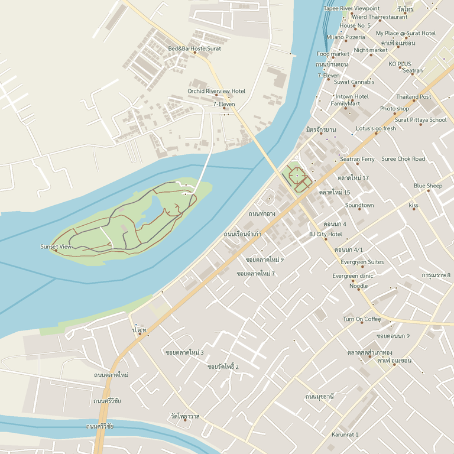

# ESP32 CYD Survival Wiki — ฉบับภาษาไทย

คู่มือเอาตัวรอดภาษาไทยสำหรับ ESP32-2432S028R (CYD 2.8 นิ้ว) พร้อมแผนที่ออฟไลน์ทั้งจังหวัด ระบบติดตาม GPS การค้นหาสถานที่ และเส้นทาง GPX รุ่น **1.6.0-th4**

## ดาวน์โหลดไฟล์พร้อมใช้

ดาวน์โหลดเฟิร์มแวร์ ชุด SD และตัวช่วยเตรียมแผนที่ได้ที่ **[GitHub Releases](https://github.com/zmikiz1423/esp32-cyd-survival-wiki-thai/releases)** ไฟล์ ZIP ขนาดใหญ่และแผนที่ไม่ได้รวมในซอร์สโค้ด Git

- [วิธีติดตั้งและคอมไพล์](README_TH.md)
- [เพิ่มหลายจังหวัดและเลือกแผนที่บนจอ](MULTI_MAPS_TH.md)
- [คู่มือแผนที่ออฟไลน์ทั้งจังหวัดและ GPS](OFFLINE_MAPS_TH.md)
- [ตัวช่วยเลือกพื้นที่ขนาดเล็ก](MAPS_TH.md)
- [ประวัติการเปลี่ยนแปลง](CHANGELOG.md)

รุ่น th4 เก็บหลายจังหวัดไว้ในการ์ดเดียวแล้วเลือกจากเมนู **แผนที่ → จังหวัด** ได้ จำชุดที่เลือกเมื่อเปิดเครื่องใหม่ ไม่กำหนดจำนวนชุดตายตัว จำนวนที่เก็บได้ขึ้นกับพื้นที่ว่างและข้อจำกัดของ SD Card แยกแต่ละจังหวัดเป็น `maps-chumphon`, `maps-krabi` โดยใช้ `maps` เดิมต่อได้

แผนที่สุราษฎร์ธานีที่เตรียมไว้มีซูม 8–16 จำนวน 55,125 ภาพ รวมพื้นที่เกาะตามขอบเขตที่ใช้ และข้อมูลสถานที่ค้นหา 6,363 รายการ สร้างจาก OpenStreetMap และตรวจไฟล์ครบแล้ว

## เครดิตและขอขอบคุณโครงการต้นฉบับ

โครงการนี้พัฒนาต่อยอดจาก **[everyday3d/esp32-cyd-survival-wiki](https://github.com/everyday3d/esp32-cyd-survival-wiki)** โดยผู้ดูแลฉบับภาษาไทยได้ขออนุญาตนำโครงการต้นฉบับมาพัฒนาเป็นเวอร์ชันภาษาไทยแล้ว

ขอขอบคุณ **Everyday3D / BoxerDawg 3D และผู้ร่วมพัฒนาโครงการต้นฉบับทุกท่าน** ที่สร้างและแบ่งปันโครงการที่เป็นประโยชน์ เปิดโอกาสให้ผู้ใช้งานนำไปต่อยอด และทำให้เกิดฉบับภาษาไทยสำหรับผู้ใช้งานในประเทศไทย

คงข้อความลิขสิทธิ์และ [MIT License ต้นฉบับ](LICENSE) ไว้ รายละเอียดโครงการต้นฉบับอ่านได้ที่ [README_UPSTREAM.md](README_UPSTREAM.md)

ข้อมูลแผนที่ © [OpenStreetMap contributors](https://www.openstreetmap.org/copyright), ไฟล์ประเทศไทยจาก Geofabrik, ขอบเขตจาก geoBoundaries / OSM และฟอนต์ Sarabun ตามใบอนุญาตที่แนบไว้

## สถานะการทดสอบ

คอมไพล์เฟิร์มแวร์และตรวจซอฟต์แวร์ ตัวช่วยดาวน์โหลด ความครบของแผนที่ และภาษาไทยแล้ว การทดสอบโมดูล GPS จริงยังรออุปกรณ์ของผู้ดูแล แผนที่ชุดนี้ไม่มีภาพดาวเทียม เส้นชั้นความสูง หรือการนำทางเลี้ยวต่อเลี้ยว
